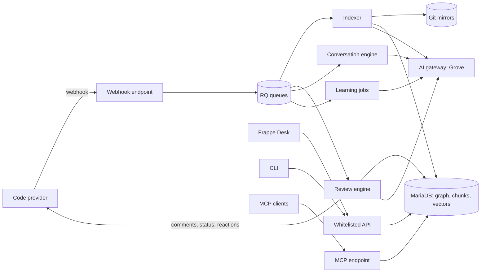

# Architecture

## Components



| Component | Package | Job |
| - | - | - |
| Webhook endpoint | `guard/webhooks/` | Checks the signature, stores the delivery, queues work. Returns in less than one second. |
| Provider adapters | `guard/providers/` | One class for each code provider. Read pull requests, write comments, statuses, reactions, approvals. |
| Git store | `guard/git/` | Keeps one bare mirror for each repository. Fetches pull request heads. Reads files and diffs. |
| Indexer | `guard/indexing/` | Parses files into entities and edges, cuts chunks, writes vectors. |
| Graph queries | `guard/graph/` | Callers, callees, definitions, impact, similar code. |
| Config resolver | `guard/config/` | Merges dashboard settings with `.guard/` and `guard.toml` files. Evaluates filters. |
| Review engine | `guard/review/` | Builds context, runs the agent, filters findings, renders and publishes. |
| Conversation engine | `guard/conversation/` | Mentions, thread replies, Chat with PR, codebase chat. |
| Learning | `guard/learning/` | Feedback, addressed detection, memories, suppression, suggested rules. |
| Knowledge base | `guard/knowledge/` | Generates and syncs repository documents. |
| Integrations | `guard/integrations/` | Jira, Confluence, Linear. |
| LLM layer | `guard/llm/` | Chat, tool calls, structured output, embeddings, usage. |
| API | `guard/api/` | Whitelisted methods for the UI, the CLI and the query API. |
| MCP | `guard/mcp/` | JSON-RPC MCP endpoint. |
| CLI | `guard/cli/` | Standalone CLI. Python standard library only. |
| Desk UI | `guard/guard/` | Workspace, form scripts, desk pages, reports, number cards, charts. |

## AI gateway

Guard sends every LLM and embedding call through one gateway. The default gateway is [Grove](https://github.com/frappe/grove). Grove serves an OpenAI-compatible front (`/v1/chat/completions`, `/v1/embeddings`, `/v1/models`) and an Anthropic-compatible front (`/v1/messages`). It holds the vendor keys, routes models, meters usage and enforces caps for each key.

Guard settings hold:

- The gateway base URL and one Grove API key.
- The dialect: `openai` (default) or `anthropic`.
- Model ids in Grove form, `<provider>/<name>`. Example: `anthropic/claude-sonnet-5-5`.
- One model for each tier, a fast model, and an embedding model.

Any other OpenAI-compatible or Anthropic-compatible endpoint also works with the same settings. Guard reads `/v1/models` to fill the model pickers. It sends the auth headers of the selected dialect. The `anthropic` dialect sends no `temperature` and forces no tool, and it sends the thinking blocks of each answer back unchanged. Claude 5 models refuse the first two, and need the third in a tool turn. A gateway answer of 402 (cap reached) or 429 (rate limit) puts the job back in the queue with a delay. It does not fail the review at once.

Some models write tool calls in their own markup, and the server can fail to parse it. DeepSeek, for example, sometimes writes a DSML tag the server does not know. Then the calls come back as text. `llm/markup.py` reads such calls when the request offered those tools, and it always removes the markup from the text, so Guard never posts it.

With no gateway set, Guard uses the offline fallback. The fallback returns empty findings and hash-based embeddings. Tests use it.

## Processes and queues

Guard uses the Frappe RQ workers. It adds no new process. A worker can run several reviews on threads (see the hosts below).

| Queue | Jobs | Timeout |
| - | - | - |
| `short` | Webhook follow-up, reactions, status updates | 5 min |
| `default` | Reviews (base, plus, and new reviews with no tier yet), thread replies, chat answers, addressed checks | 30 min, 2 h for a review with no tier yet |
| `long` | Full indexing, apex reviews, knowledge base builds, sandbox runs | 2 h |

A bench can also have dedicated review queues: workers for them in the `workers` key of `common_site_config.json`. Guard uses each one that the bench has and that a worker listens on. For the others it uses the shared queue above: `default`, or `long` for apex. So a self-hosted bench needs no new queue, and a queue in the config with no worker running, for example before `bench setup supervisor`, does not hold reviews. Guard counts the workers of a queue again each minute.

| Queue | Jobs | Timeout |
| - | - | - |
| `guard-review` | New reviews with no tier yet, up to the gate | 2 h |
| `guard-base` | Base reviews | 30 min |
| `guard-plus` | Plus reviews | 30 min |
| `guard-apex` | Apex reviews | 2 h |

A job queued with no tier moves the review after the gate, when its tier has a dedicated queue. An intake job also moves the review to the shared queue when its tier has no worker, so a long review does not hold the intake worker. A job queued for a requested tier moves too when the gate picks a higher one, because a request sets only the lowest tier. The move: the review goes back to Queued with the stage `waiting for <queue>`, and a job on that queue reviews it. The new job does the stages before the agents again. They take seconds, and the index is fresh. The moved job has its own RQ job id (`-moved` at the end), because the first job still runs when it is queued. A moved job does not move again, so a review moves at most once in an attempt. Retries and restarts know the tier, so they go to its queue at once. A review that runs inline, as in an eval, never moves. The worker count of each queue limits the reviews of its tier that run at a time. `max_concurrent_reviews` still limits all of them together, and a review in the intake job counts as running. So set it to the sum of the review workers, the intake workers included, or more.

A review spends most of its time waiting for the AI gateway, so one worker can run several. With `reviews_per_worker` (Guard Settings, at most 16) above 1, `enqueue_review` also makes sure that a host can take a job on a dedicated review queue. The shared queues get no host, because it would hold a worker that other jobs need. The host: `guard.review.host.serve` on the same queue, with the job id `guard-review-host-<queue>-<n>`. A host is queued at the front, so the next free worker becomes a host. It takes review jobs of its site off its queue (`LREM`, so only one host or worker gets a job) and runs each with Frappe's `execute_job` on its own thread: a new context, its own site connection, its own commit. It runs up to `reviews_per_worker` reviews at once, and ends when it has none left. An idle worker still takes a review job itself, so hosts take only the jobs that would wait for a worker. A new host is queued only when no host is queued and every running host is full. A review takes a free thread of a running host with an atomic Redis decrement, so a burst of reviews does not count one free thread many times. A started host that has not reported its free threads for a minute is dead, and its job id is used again. An error in `ensure_host` does not fail the request: the review job is queued, and a worker runs it alone. Then `max_concurrent_reviews` can go up to the review workers times `reviews_per_worker`, as far as the gateway takes the load.

A host job runs for up to 4 hours. It takes a review only when the timeout of its job fits in the time that the host has left, and it passes that timeout to the review, so the agents stop in time. A taken job leaves RQ, so its id is free for a park or a retry. A Redis mark with a short life tells `has_job` that the review runs. The host renews it every few seconds. When the worker dies, the mark ends and `fail_dead_reviews` starts the review again, as for a review job. RQ ends a job that passes its timeout by killing the process, so a host that passes its timeout stops all of its reviews. Each thread keeps its own tree-sitter parsers, because a parser is not safe to share.

The mark of a running review holds a token of its thread. A park keeps the attempt, so a newer job of the review can run while the old thread ends: the old thread then does not renew or delete the mark of the newer one. If the host fails to free the id of a job that it took off the queue, it puts the job back. A job that is out of the queue but still queued in RQ counts as enqueued for good. An error in one look at the queue is logged, and the host goes on: its threads, and so its reviews, end with the job. The host closes its own database connection while it waits, and Frappe connects again for the commit at the end of the job.

Limits of a hosted review. RQ does not know the review job on the thread, so `get_current_job()` is None there. The review gets its timeout from the host, an Error Log has no job details, and the database statement timeout of jobs does not apply. Nothing kills one thread: a review that hangs keeps its slot until the host ends, and `fail_dead_reviews` marks it failed after its timeout. A deploy waits for the reviews of a host, as for one long review job, and a worker that is killed restarts them.

The gate picks the tier inside the review job, so a new review gets the timeout of apex. The agents stop 6 minutes before the job timeout, or the base and plus limit of 30 minutes, and submit what they have. The apex parts may use two thirds of that time, and the pass across the parts the rest. A job that the worker kills loses all of its work.

Thread replies and addressed checks wait for a busy or failing gateway, as reviews do. The job stores an attempt and a retry time, and stops. A job every minute queues the work again when the retry time has passed. After 120 s, 10 min and 30 min, the last attempt fails and logs its traceback.

Job keys stop duplicate work: one review job for each pull request and head commit, one index job for each repository and branch.

A job that writes a Pull Request and its Code Review in one transaction writes the Pull Request first. The webhook handler and polling commit the Pull Request before their git work and provider calls, and the review commits before its provider calls, so neither holds a row lock for long. The webhook handler lets a deadlock or a lock timeout go up, and Frappe runs the job again. The Webhook Delivery is the truth, not the queue: every 5 minutes, `requeue_lost_deliveries` queues again a delivery that is still Received after 5 minutes and has no job, for example after a deploy lost it. It skips deliveries older than 6 hours, because a review or a reply that late does more harm than good. A delivery whose job stops 3 times without a result is Failed. A review that fails logs its traceback in the Error Log, with the Code Review as the reference.

## Main data flow: a review

1. The provider sends a `pull_request` event. The webhook endpoint checks the signature and writes a Webhook Delivery.
2. The endpoint maps the event to a Pull Request record and an event kind (`open`, `push`, `rebase`).
3. The config resolver reads the base branch policy and the source branch config, and evaluates filters and permissions.
4. If the event passes, Guard creates a Code Review in status Queued and queues `guard.review.pipeline.run`.
5. The job fetches the head into the mirror and computes the diff from the merge base.
6. The job makes sure the base index is fresh. If not, it runs an incremental index first.
7. The context builder queries the graph and collects rules, memories, knowledge base pages, tickets and cross-repo context.
8. The agent reviews the diff with tools and reports findings.
9. Guard verifies, deduplicates, suppresses and scores the findings.
10. The renderer builds the summary comment and the inline comments. The adapter publishes them.
11. Guard sets the status check and the reactions, and checks auto-approve.
12. Desk gets a realtime event and refreshes the open Pull Request form.

## Storage

| Data | Where |
| - | - |
| Records | MariaDB through DocTypes. |
| Vectors | MariaDB `VECTOR` column in the `guard_vector` table with an HNSW index. Fallback: numpy cosine on a float32 blob. |
| Lexical search | MariaDB `FULLTEXT` index on chunk text. |
| Git mirrors | `sites/<site>/private/guard/git/<repository>.git` |
| Sandbox work trees | `sites/<site>/private/guard/sandbox/<review>/` and removed after the run. |
| Secrets | Frappe Password fields. |

## Module layout

```text
guard/
  guard/doctype/        DocTypes (module "Guard") and form scripts
  guard/page/           desk pages: guard_pr (list, overview, tour, diff, chat), guard_chat, guard_cli_login
  guard/report/         script reports: guard_analytics, bugs_caught, my_guard
  guard/workspace/, guard/number_card/, guard/dashboard_chart/, guard/number_cards.py
  analytics.py          metrics for reports, number cards and MCP
  permissions.py        team-scoped permission hooks
  settings.py           typed Guard Settings access
  api/                  ui.py (Desk), v2.py (query API), cli.py (CLI), public.py (signed links)
  cli/                  guard_cli.py, the standalone CLI
  config/               schema.py, resolver.py, dashboard.py, gate.py, globs.py
  conversation/         mentions.py, threads.py, answer.py, chat.py, codebase.py, tour.py
  git/                  store.py, diff.py, repository.py
  graph/                queries.py, overlay.py (pull request graph, blast radius, impact diagram)
  indexing/             indexer.py, parser.py, languages.py, symbols.py, resolver.py, frappe_plugin.py,
                        chunker.py, selection.py, vectors.py, jobs.py
  integrations/         tickets.py (Jira, Confluence, Linear)
  knowledge/            builder.py, store.py
  learning/             feedback.py, memory_writer.py, memories.py, addressed.py, suppression.py,
                        suggestions.py, approve.py
  llm/                  client.py, openai_dialect.py, anthropic_dialect.py, markup.py, offline.py, embeddings.py, http.py
  mcp/                  server.py, tools.py
  providers/            base.py, github.py, sync.py
  review/               pipeline.py, run.py, context.py, task.py, agent.py, prompts.py, findings.py,
                        checks.py, verify.py, render.py, publish.py, sandbox.py, trigger.py, jobs.py,
                        cli_review.py, crossrepo.py, rule_files.py, permissions.py, links.py, tips.py
  webhooks/             endpoint.py, events.py, github.py, handler.py, polling.py
```
