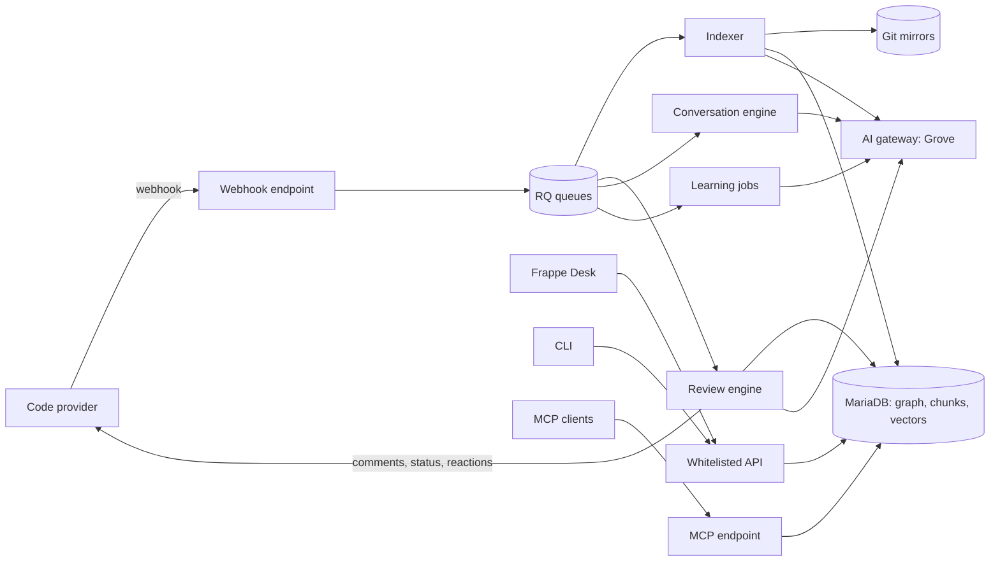

# Architecture

## Components



| Component | Package | Job |
| - | - | - |
| Webhook endpoint | `guard/webhooks/` | Checks the signature, stores the delivery, queues work. Returns in less than one second. |
| Provider adapters | `guard/providers/` | One class for each code provider. Read pull requests, write comments, statuses, reactions, approvals. |
| Git store | `guard/git/` | Keeps one bare mirror for each repository. Fetches pull request heads. Reads files and diffs. |
| Indexer | `guard/indexing/` | Parses files into entities and edges, cuts chunks, writes vectors. |
| Graph queries | `guard/graph/` | Callers, callees, definitions, impact, similar code. |
| Config resolver | `guard/config/` | Merges dashboard settings with `.guard/` and `guard.toml` files. Evaluates filters. |
| Review engine | `guard/review/` | Builds context, runs the agent, filters findings, renders and publishes. |
| Conversation engine | `guard/conversation/` | Mentions, thread replies, Chat with PR, codebase chat. |
| Learning | `guard/learning/` | Feedback, addressed detection, memories, suppression, suggested rules. |
| Knowledge base | `guard/knowledge/` | Generates and syncs repository documents. |
| Integrations | `guard/integrations/` | Jira, Confluence, Linear. |
| LLM layer | `guard/llm/` | Chat, tool calls, structured output, embeddings, usage. |
| API | `guard/api/` | Whitelisted methods for the UI, the CLI and the query API. |
| MCP | `guard/mcp/` | JSON-RPC MCP endpoint. |
| CLI | `guard/cli/` | Standalone CLI. Python standard library only. |
| Desk UI | `guard/guard/` | Workspace, form scripts, desk pages, reports, number cards, charts. |

## AI gateway

Guard sends every LLM and embedding call through one gateway. The default gateway is [Grove](https://github.com/frappe/grove). Grove serves an OpenAI-compatible front (`/v1/chat/completions`, `/v1/embeddings`, `/v1/models`) and an Anthropic-compatible front (`/v1/messages`). It holds the vendor keys, routes models, meters usage and enforces caps for each key.

Guard settings hold:

- The gateway base URL and one Grove API key.
- The dialect: `openai` (default) or `anthropic`.
- Model ids in Grove form, `<provider>/<name>`. Example: `anthropic/claude-sonnet-5-5`.
- One model for each tier, a fast model, and an embedding model.

Any other OpenAI-compatible or Anthropic-compatible endpoint also works with the same settings. Guard reads `/v1/models` to fill the model pickers. A gateway answer of 402 (cap reached) or 429 (rate limit) puts the job back in the queue with a delay. It does not fail the review at once.

With no gateway set, Guard uses the offline fallback. The fallback returns empty findings and hash-based embeddings. Tests use it.

## Processes and queues

Guard uses the Frappe RQ workers. It adds no new process.

| Queue | Jobs | Timeout |
| - | - | - |
| `short` | Webhook follow-up, reactions, status updates, thread replies | 5 min |
| `default` | Reviews (base, plus), chat answers, addressed checks | 30 min |
| `long` | Full indexing, apex reviews, knowledge base builds, sandbox runs | 2 h |

Job keys stop duplicate work: one review job for each pull request and head commit, one index job for each repository and branch.

## Main data flow: a review

1. The provider sends a `pull_request` event. The webhook endpoint checks the signature and writes a Webhook Delivery.
2. The endpoint maps the event to a Pull Request record and an event kind (`open`, `push`, `rebase`).
3. The config resolver reads the base branch policy and the source branch config, and evaluates filters and permissions.
4. If the event passes, Guard creates a Code Review in status Queued and queues `guard.review.pipeline.run`.
5. The job fetches the head into the mirror and computes the diff from the merge base.
6. The job makes sure the base index is fresh. If not, it runs an incremental index first.
7. The context builder queries the graph and collects rules, memories, knowledge base pages, tickets and cross-repo context.
8. The agent reviews the diff with tools and reports findings.
9. Guard verifies, deduplicates, suppresses and scores the findings.
10. The renderer builds the summary comment and the inline comments. The adapter publishes them.
11. Guard sets the status check and the reactions, and checks auto-approve.
12. Desk gets a realtime event and refreshes the open Pull Request form.

## Storage

| Data | Where |
| - | - |
| Records | MariaDB through DocTypes. |
| Vectors | MariaDB `VECTOR` column in the `guard_vector` table with an HNSW index. Fallback: numpy cosine on a float32 blob. |
| Lexical search | MariaDB `FULLTEXT` index on chunk text. |
| Git mirrors | `sites/<site>/private/guard/git/<repository>.git` |
| Sandbox work trees | `sites/<site>/private/guard/sandbox/<review>/` and removed after the run. |
| Secrets | Frappe Password fields. |

## Module layout

```text
guard/
  guard/doctype/        DocTypes (module "Guard") and form scripts
  guard/page/           desk pages: guard_pull_request (tour, diff, chat), guard_codebase_chat
  guard/report/         script reports: analytics, bugs caught, my guard
  guard/workspace/      Guard workspace
  guard/number_card/, guard/dashboard_chart/
  api/                  whitelisted methods: ui.py, v2.py, cli.py, analytics.py, public.py
  cli/                  standalone CLI
  config/               resolver.py, schema.py, filters.py, globs.py
  conversation/         mentions.py, threads.py, chat.py, actions.py, tour.py
  git/                  store.py, diff.py
  graph/                queries.py, impact.py
  indexing/             indexer.py, parser.py, languages/, chunker.py, vectors.py
  integrations/         jira.py, linear.py, context.py
  knowledge/            builder.py, sync.py
  learning/             feedback.py, addressed.py, memories.py, suppression.py, suggestions.py
  llm/                  client.py, openai_dialect.py, anthropic_dialect.py, offline.py, embeddings.py
  mcp/                  server.py, tools.py
  providers/            base.py, github.py, gitlab.py, gitea.py, bitbucket.py
  review/               pipeline.py, context.py, agent.py, tools.py, prompts.py, findings.py,
                        scoring.py, render.py, publish.py, approve.py, sandbox.py
  webhooks/             endpoint.py, github.py, gitlab.py, gitea.py, bitbucket.py
```
