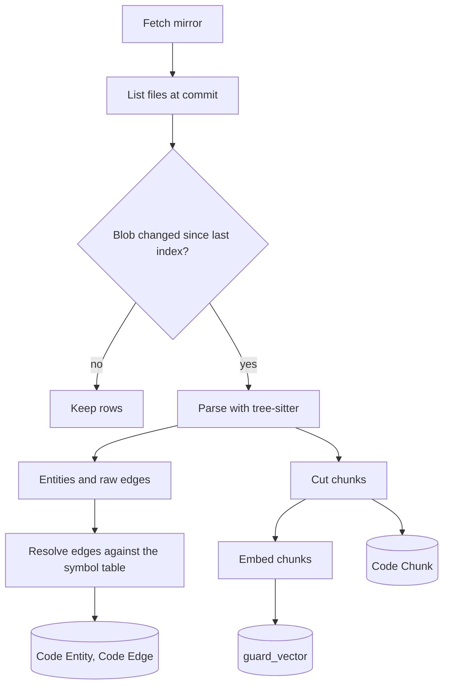

# Codebase graph

The graph is the core of Guard. Every review, chat answer and API query starts from it.

## Goals

1. Answer "who calls this", "what does this call", "where is this defined" and "what looks like this" in less than 200 ms for a repository with 100,000 entities.
2. Work for every language. Languages with a parser get entities and edges. Other files still get chunks and search.
3. Re-index a push in time that grows with the size of the change, not the size of the repository.

## Indexing pipeline

### 1. Mirror

- Guard keeps one bare mirror for each repository at `private/guard/git/<repository>.git`.
- Guard passes credentials with `http.extraHeader` for each command. It never writes a token to disk.
- A pull request head is fetched into `refs/guard/pr/<number>`. Forks work through the provider pull ref (`pull/<n>/head`, `merge-requests/<n>/head`) or through the head clone URL.

### 2. File selection

The indexer reads `git ls-tree -r -l <sha>`. It skips:

- Files larger than 1 MB.
- Binary files: a NUL byte in the first 8 KB, or a known binary extension.
- Vendored and generated paths: `node_modules/`, `vendor/`, `dist/`, `build/`, `.git/`, `*.min.js`, `*.map`, lock files, and paths marked `linguist-generated` or `linguist-vendored` in `.gitattributes`.

### 3. Incremental update

- Each file entity stores the blob sha as `content_hash`.
- On a new commit, `git diff --name-status <old> <new>` gives the changed paths.
- The indexer deletes the rows of changed and removed paths and parses only changed and added paths.
- After the parse, it resolves edges again for the files that import or call the changed files.
- A full rebuild runs when the parser version changes or when an admin asks for it.
- A push to the default branch queues an update. A push can get lost, for example when a deploy loses its delivery. So every hour, `catch_up` fetches the default branch of each repository whose index is completed, and queues an update when the head is not the indexed sha. A review does not do this: it uses any completed index.

### 4. Parsing

Guard uses tree-sitter through `tree-sitter-language-pack`. The pack's structure API gives definitions with their spans, signatures and children. The pack's tags query for each language gives calls and, when the structure API has none, definitions. `guard/indexing/languages.py` holds file detection, import parsing and base-class parsing for each language. The captures are:

| Capture | Meaning |
| - | - |
| `@definition.class`, `@definition.function`, `@definition.method`, `@definition.type`, `@definition.variable` | A definition, with `@name` |
| `@reference.call` | A call, with `@name` and the full callee text |
| `@import` | An import, with the module and the imported names |
| `@inherit` | A base class or an implemented interface |

Supported first: Python, JavaScript, TypeScript, TSX, Vue (script block), Go, Rust, Java, Kotlin, Ruby, PHP, C, C++, C#, Swift, Scala. A missing grammar falls back to file-level indexing.

### 5. Entities

| Kind | Example | Parent |
| - | - | - |
| file | `src/users/service.py` | none |
| class | `UserService` | file |
| function | `get_user` | file |
| method | `UserService.update_email` | class |
| type, interface | `UserData` | file |
| variable | `CONFIG` (module level) | file |

`qualified_name` is `<module path>.<Class>.<member>`. For Python the module path is dotted (`app.users.service`). For other languages it is the path without the extension. The dotted form lets string references resolve (see edges).

`signature` is the definition line up to the body. Guard compares the base and the head signature to find contract changes.

### 6. Edges

| Kind | From | To |
| - | - | - |
| contains | file or class | class, function, method |
| imports | file | file or entity |
| calls | function, method or file | function, method or class |
| inherits | class | class or interface |
| references | any | entity named by a string literal |

String references cover dotted paths in strings, for example `"app.users.service.get_user"` in a hooks file, a job queue call or a route table. Guard adds a `references` edge when the string matches the `qualified_name` of an entity.

### 7. Edge resolution

A raw call has a callee name and the callee text (`self.validate`, `db.update`, `get_user`). Guard resolves it in this order and stops at the first match:

1. A method on the same class or on a base class, for `self.x` and `this.x`.
2. A definition in the same file.
3. A name that the file imports, followed to its definition.
4. The only definition with that name in the repository.

When no step matches, `target_entity` stays blank and `target_name` keeps the name. Caller queries include these name-only edges and mark them as "possible".

### 8. Framework plugins

A plugin adds entities and edges that a parser cannot see. A plugin runs when its marker file exists.

| Plugin | Marker | Adds |
| - | - | - |
| Frappe | `hooks.py` next to `modules.txt` | `doctype` and `field` entities from DocType JSON. `Link` and `Table` fields as `references` edges between doctypes. Dotted paths in `hooks.py` as `references` edges. `frappe.call`, `frappe.xcall` and `frm.call` method strings in JavaScript as `calls` edges to the Python method. `@frappe.whitelist()` marks an entity as an entry point, with `allow_guest` in the signature. A controller file links to its doctype. |

### 8b. HTTP routes

For every language, Guard reads route definitions, routers with a path prefix and HTTP client calls from the source lines. Routes become `route` entities, routers become `router` entities and client calls become `references` edges to `http:<verb> <path>`. Refer to [Validation across repositories](10-integrations.md#validation-across-repositories).

### 9. Chunks

- One chunk for each function and method up to 150 lines. Longer bodies split into 100-line windows with 15 lines of overlap.
- One chunk for each class header: the signature, the docstring and the attribute lines.
- Module-level code outside definitions goes into 100-line windows.
- Files with no parser go into 100-line windows.
- Each chunk starts with a header line: `<path>:<start>-<end> <qualified_name>`. The header improves search quality.

### 10. Vectors

- Guard embeds chunks in batches of 64 through the gateway embedding model.
- With no embedding model, Guard uses a hash embedding: tokens and token pairs hashed into the configured dimension. It is lexical, but it keeps the same code path.
- Vectors go into `guard_vector`. On MariaDB 11.7 or later the column is `VECTOR(n)` with a cosine HNSW index. On other databases the column is a blob and Guard ranks with numpy.

## Graph queries

`guard/graph/queries.py` has one class, `CodeGraph`, bound to one index.

| Method | Returns |
| - | - |
| `definitions(name, kind=None)` | Entities with that name or qualified name. |
| `outline(path)` | Entities in a file, in line order. |
| `callers(entity, depth=1)` | Entities that call the entity. Each has `resolved` true or false. |
| `callees(entity)` | Entities that the entity calls. |
| `references(entity)` | Imports and string references to the entity. |
| `impact(entities, depth=2)` | Callers to the given depth, grouped by file, with counts. |
| `siblings(entity)` | Entities of the same kind with shared name tokens, in the same file or the same parent directory. Example: `update_user_email` and `update_user_profile`. |
| `similar(text or entity, k)` | Vector nearest neighbors. |
| `search(query, k)` | Hybrid search: FULLTEXT rank and vector rank, merged with reciprocal rank fusion. |
| `dependencies(path)` | Files that the file imports, and files that import it. |

## Pull request graph

The base index describes the base branch. A pull request changes some files, so Guard builds a small overlay graph for the head:

1. Parse each changed file at the head commit in memory. Do not write rows.
2. Map each diff hunk to the head entities whose line range overlaps it. These are the **changed entities**.
3. Find the base entity with the same `qualified_name`. If none, the entity is new.
4. Compare signatures. A difference marks a **contract change**.
5. For each changed entity, read its callers from the base index. A caller "may break" when all of these are true:
   - The pull request does not change the line of the call.
   - The entity was deleted, or its signature changed.
   - The call does not fit the new signature. For Python, Guard compares the arguments of the call with the parameters: required parameters, defaults, keyword-only parameters, `*args` and `**kwargs`. When Guard cannot parse the call or the signature, the caller may break.
6. For each contract change, collect the call sites of callers that may break: the call line with three lines around it.
7. Resolve the new calls in head code against the base symbol table and the overlay.

The review context ([05-review-engine.md](05-review-engine.md)) gets, for each changed entity: the base and head bodies, callers, callees, siblings, similar code and the call sites at risk.

## Lazy summaries

When a review, a chat answer or the knowledge base needs a file summary, Guard generates it with the fast model and caches it by blob sha. Guard does not summarize every file at index time, because that costs one LLM call for each file.

## Limits

| Limit | Default |
| - | - |
| File size | 1 MB |
| Files for each repository | 200,000 |
| Chunk size | 150 lines |
| Callers returned for each entity | 50 |
| Impact depth | 2 |
