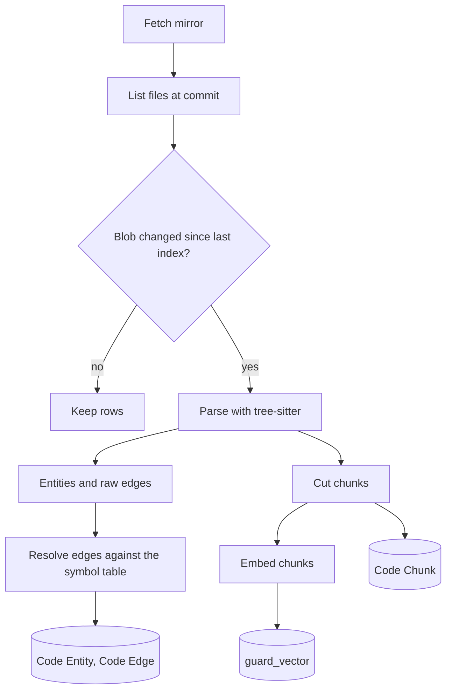

# Codebase graph

The graph is the core of Guard. Every review, chat answer and API query starts from it.

## Goals

1. Answer "who calls this", "what does this call", "where is this defined" and "what looks like this" in less than 200 ms for a repository with 100,000 entities.
2. Work for every language. Languages with a parser get entities and edges. Other files still get chunks and search.
3. Re-index a push in time that grows with the size of the change, not the size of the repository.

## Indexing pipeline

### 1. Mirror

- Guard keeps one bare mirror for each repository at `private/guard/git/<repository>.git`.
- Guard passes credentials with `http.extraHeader` for each command. It never writes a token to disk.
- A pull request head is fetched into `refs/guard/pr/<number>`. Forks work through the provider pull ref (`pull/<n>/head`, `merge-requests/<n>/head`) or through the head clone URL.

### 2. File selection

The indexer reads `git ls-tree -r -l <sha>`. It skips:

- Files larger than 1 MB.
- Binary files: a NUL byte in the first 8 KB, or a known binary extension.
- Vendored and generated paths: `node_modules/`, `vendor/`, `dist/`, `build/`, `.git/`, `*.min.js`, `*.map`, lock files, and paths marked `linguist-generated` or `linguist-vendored` in `.gitattributes`.

### 3. Incremental update

- Each file entity stores the blob sha as `content_hash`.
- On a new commit, `git diff --name-status <old> <new>` gives the changed paths.
- The indexer deletes the rows of changed and removed paths and parses only changed and added paths.
- After the parse, it resolves edges again for the files that import or call the changed files.
- A full rebuild runs when the parser version changes or when an admin asks for it.
- A push to the default branch queues an update. So does a push to a branch that `index_branches` lists ([Branch indexes](#branch-indexes)). A push can get lost, for example when a deploy loses its delivery. So every hour, `catch_up` fetches the default branch of each repository whose index is completed, and queues an update when the head is not the indexed sha. It does the same for each completed branch index. A review does not do this: it uses any completed index.

### 4. Parsing

Guard uses tree-sitter through `tree-sitter-language-pack`. The pack's structure API gives definitions with their spans, signatures and children. The pack's tags query for each language gives calls and, when the structure API has none, definitions. `guard/indexing/languages.py` holds file detection, import parsing and base-class parsing for each language. The captures are:

| Capture | Meaning |
| - | - |
| `@definition.class`, `@definition.function`, `@definition.method`, `@definition.type`, `@definition.variable` | A definition, with `@name` |
| `@reference.call` | A call, with `@name` and the full callee text |
| `@import` | An import, with the module and the imported names |
| `@inherit` | A base class or an implemented interface |

Supported first: Python, JavaScript, TypeScript, TSX, Vue (script block), Go, Rust, Java, Kotlin, Ruby, PHP, C, C++, C#, Swift, Scala. A missing grammar falls back to file-level indexing.

### 5. Entities

| Kind | Example | Parent |
| - | - | - |
| file | `src/users/service.py` | none |
| class | `UserService` | file |
| function | `get_user` | file |
| method | `UserService.update_email` | class |
| type, interface | `UserData` | file |
| variable | `CONFIG` (module level) | file |

`qualified_name` is `<module path>.<Class>.<member>`. For Python the module path is dotted (`app.users.service`). For other languages it is the path without the extension. The dotted form lets string references resolve (see edges).

`signature` is the definition line up to the body. Guard compares the base and the head signature to find contract changes.

### 6. Edges

| Kind | From | To |
| - | - | - |
| contains | file or class | class, function, method |
| imports | file | file or entity |
| calls | function, method or file | function, method or class |
| inherits | class | class or interface |
| references | any | entity named by a string literal |

String references cover dotted paths in strings, for example `"app.users.service.get_user"` in a hooks file, a job queue call or a route table. Guard adds a `references` edge when the string matches the `qualified_name` of an entity.

### 7. Edge resolution

A raw call has a callee name and the callee text (`self.validate`, `db.update`, `get_user`). Guard resolves it in this order and stops at the first match:

1. A method on the same class or on a base class, for `self.x` and `this.x`.
2. A definition in the same file.
3. A name that the file imports, followed to its definition.
4. The only definition with that name in the repository.

When no step matches, `target_entity` stays blank and `target_name` keeps the name. Caller queries include these name-only edges and mark them as "possible".

### 8. Framework plugins

A plugin adds entities and edges that a parser cannot see. A plugin runs when its marker file exists.

| Plugin | Marker | Adds |
| - | - | - |
| Frappe | `hooks.py` next to `modules.txt` | `doctype` and `field` entities from DocType JSON. `Link` and `Table` fields as `references` edges between doctypes. Dotted paths in `hooks.py` as `references` edges. `frappe.call`, `frappe.xcall` and `frm.call` method strings in JavaScript as `calls` edges to the Python method. `@frappe.whitelist()` marks an entity as an entry point, with `allow_guest` in the signature. A controller file links to its doctype. |

### 8b. HTTP routes

For every language, Guard reads route definitions, routers with a path prefix and HTTP client calls from the source lines. Routes become `route` entities, routers become `router` entities and client calls become `references` edges to `http:<verb> <path>`. Refer to [Validation across repositories](10-integrations.md#validation-across-repositories).

### 9. Chunks

- One chunk for each function and method up to 150 lines. Longer bodies split into 100-line windows with 15 lines of overlap.
- One chunk for each class header: the signature, the docstring and the attribute lines.
- Module-level code outside definitions goes into 100-line windows.
- Files with no parser go into 100-line windows.
- Each chunk starts with a header line: `<path>:<start>-<end> <qualified_name>`. The header improves search quality.

### 10. Vectors

- Guard embeds chunks in batches of 64 through the gateway embedding model.
- With no embedding model, Guard uses a hash embedding: tokens and token pairs hashed into the configured dimension. It is lexical, but it keeps the same code path.
- Vectors go into `guard_vector`. On MariaDB 11.7 or later the column is `VECTOR(n)` with a cosine HNSW index. On other databases the column is a blob and Guard ranks with numpy.

### 11. Branch indexes

By default Guard indexes only the default branch. The config key `index_branches` ([06-configuration.md](06-configuration.md)) lists other branches, as globs, that get an index of their own, for example `version-*-hotfix`. A pull request to such a branch then gets callers, callees, blast radius and similar code of that branch.

- Guard reads the setting at push time and in `catch_up`, so it reads only the cheap layers: the dashboard (Review Settings of the organization or the team) and the root config at the head of the default branch in the mirror. Nested configs do not count, and an error in a nested config does not matter. A pull request cannot add a branch for itself.
- When Guard cannot read the setting, it does nothing: it does not queue and does not drop an index. This is so when git fails, when a root config file in the tree cannot be read, or when a root config or the dashboard has an error, for example invalid TOML. An empty list would drop every index that Guard made.
- An index that Guard makes for the setting has `auto` set on its Repository Index. An index that the query API makes has not.
- The first review of a pull request to a listed branch queues a full index of the branch on the `long` queue, and does not wait for it: the review uses the index of the default branch with a note. A later review uses the branch index when it is completed. A push to a listed branch queues an incremental update. `catch_up` updates them as it updates the default branch. A failed run blocks indexing of the branch for an hour, as on the default branch.
- A repository has at most 5 branch indexes (`MAX_BRANCH_INDEXES` in `guard/indexing/branches.py`). Each one is a full copy of the entity, edge and chunk rows and of the vectors. The limit counts the indexes with `auto` set whose branch the setting lists. In `catch_up` it counts only branches that the remote still has. The oldest indexes win: when more of them exist than the limit, for example after a change of the setting, the ones created first are used, and `catch_up` drops the others. A new branch never takes the place of a branch that has an index. Past the limit, Guard logs a warning and does not index the branch. An index of the query API does not count, and a review of a listed branch can use it.
- Every hour, `catch_up` drops an index with `auto` set when the setting no longer lists its branch or the index is past the limit. It drops any index of a branch other than the default branch when the remote no longer has the branch. An index of the query API for a branch that the setting does not list stays, and `catch_up` does not update it.
- `catch_up` takes the branch list of the remote (`git ls-remote --heads`) as complete only when it has the default branch. Else it drops nothing in that repository: an empty or partial answer is not a list of deleted branches.
- A drop deletes the Code Edge, Code Entity and Code Chunk rows and the `guard_vector` rows of the chunks in batches of 5,000 rows, with a commit after each batch, and then the Repository Index. First it sets the index to `failed` with no sha and commits, so reviews and runs that read it skip it. Then it checks the reviews again. When a review of the branch started in the meantime, it puts the old status and sha back and stops.
- A drop needs the lock of the index and no queued or running review of a pull request to its branch. Else the next `catch_up` tries again. The status does not matter: a run holds the lock while it writes, so a `cloning` or `processing` index without the lock is a run whose worker died. A `submitted` index has a job that has not started. When the job starts, `run_index` finds no index and stops without an error.
- `catch_up` never drops the index of the default branch. A failure in one repository does not stop the others, and a git error on one branch does not stop the other branches.
- Branch names are compared without case, as MariaDB compares the `branch` column.
- `index_status`, `default_index` and the knowledge base stay about the default branch.

Cost: each listed branch costs as much storage as the default branch. The first index embeds every chunk once. Later pushes are incremental, as on the default branch.

## Graph queries

`guard/graph/queries.py` has one class, `CodeGraph`, bound to one index.

| Method | Returns |
| - | - |
| `definitions(name, kind=None)` | Entities with that name or qualified name. |
| `outline(path)` | Entities in a file, in line order. |
| `callers(entity, depth=1)` | Entities that call the entity. Each has `resolved` true or false. |
| `callees(entity)` | Entities that the entity calls. |
| `references(entity)` | Imports and string references to the entity. |
| `impact(entities, depth=2)` | Callers to the given depth, grouped by file, with counts. |
| `siblings(entity)` | Entities of the same kind with shared name tokens, in the same file or the same parent directory. Example: `update_user_email` and `update_user_profile`. |
| `similar(text or entity, k)` | Vector nearest neighbors. |
| `search(query, k)` | Hybrid search: FULLTEXT rank and vector rank, merged with reciprocal rank fusion. |
| `dependencies(path)` | Files that the file imports, and files that import it. |

## Pull request graph

The base index is the index of the base branch when `index_branches` lists it and its index is completed ([Branch indexes](#branch-indexes)). Else it is the index of the default branch, also for a pull request to another branch. Then the agent gets a note: the graph is of a commit of the default branch, not of the base branch, so it checks callers and callees in the code at the base. Every consumer in the review (the overlay, the checks, cross-repo callers and the agent tools) uses the same index. A pull request changes some files, so Guard builds a small overlay graph for the head:

1. Parse each changed file at the head commit in memory. Do not write rows.
2. Map each diff hunk to the head entities whose line range overlaps it. These are the **changed entities**.
3. Parse each changed file at the merge base too. The base entity has the same `qualified_name`: in the same file, or, after a move, in the file where the base index has it, when the merge base has it there too. If none, the entity is new. An entity of the file at the merge base that the head does not have is deleted.
   - The lines and the signature of a base entity come from the merge base, not from the index: the index can be of a later commit of the base branch, with entities that the change never saw. The row of the index with the same `qualified_name` gives the callers. A base entity that the index does not have gets no callers.
4. Compare signatures. A difference marks a **contract change**.
5. For each changed entity, read its callers from the base index. A caller "may break" when all of these are true:
   - The pull request does not change the line of the call.
   - The entity was deleted, or its signature changed.
   - The call does not fit the new signature. For Python, Guard compares the arguments of the call with the parameters: required parameters, defaults, keyword-only parameters, `*args` and `**kwargs`. When Guard cannot parse the call or the signature, the caller may break.
6. For each contract change, collect the call sites of callers that may break: the call line with three lines around it.
7. The tests of a changed entity are the test files that reach it in two levels of callers in the base index, and the test files of the change that call it by name. A changed public function with no test is listed as "no test path".
8. Resolve the new calls in head code against the base symbol table and the overlay.

The review context ([05-review-engine.md](05-review-engine.md)) gets, for each changed entity: the base and head bodies, callers, callees, siblings, similar code and the call sites at risk.

## Lazy summaries

When a review, a chat answer or the knowledge base needs a file summary, Guard generates it with the fast model and caches it by blob sha. Guard does not summarize every file at index time, because that costs one LLM call for each file.

## Limits

| Limit | Default |
| - | - |
| File size | 1 MB |
| Files for each repository | 200,000 |
| Chunk size | 150 lines |
| Callers returned for each entity | 50 |
| Impact depth | 2 |
| Branch indexes for each repository, apart from the default branch | 5 |
| Rows deleted in one batch when Guard drops a branch index | 5,000 |
